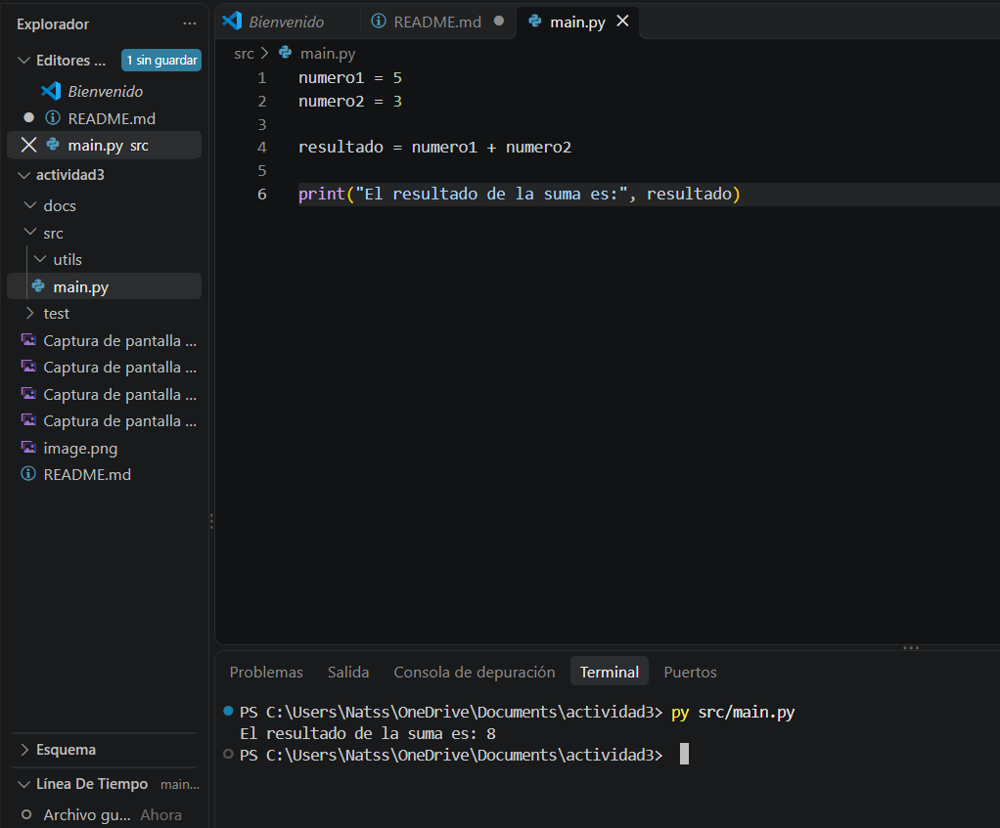

## Exploracion de Componentes del IDE, Personalizacion y Creacion de un Proyecto Estructurado

## 1. Exploracion de los proyectos de un IDE

*Introduccion*

En esta primera parte de la actividad exploré los componentes principales de Visual Studio Code para conocer su funcionamiento y aprender a utilizar sus herramientas. Durante el proceso identifiqué el editor de código, el explorador de archivos, la terminal integrada, la barra de estado, los menús principales y las ventanas de herramientas. También organicé las evidencias mediante capturas de pantalla para documentar lo realizado.

## 1.2 Explorar el editor de codigo


Abrí el archivo main.py desde el Explorador de archivos de Visual Studio Code para reconocer el área de edición.

El editor de código es el espacio principal donde se escriben, consultan y modifican las instrucciones de un programa. Permite trabajar con diferentes lenguajes de programación y facilita la lectura del código mediante el resaltado de sintaxis.

## 1.3 Explorar el Explorador de archivos


Procedimiento realizado: utilicé el Explorador de archivos para crear y organizar las carpetas src, docs y tests, además del archivo README.md. También organicé dentro de src el archivo principal main.py y la carpeta auxiliar utils.

Función: este panel permite visualizar y administrar la estructura del proyecto. Desde allí se pueden crear, abrir, renombrar y organizar archivos y carpetas.

## 1.4 Explorar la terminal integrada



La terminal integrada se encuentra en la parte inferior de Visual Studio Code. Permite escribir comandos y ejecutar programas sin salir del entorno de desarrollo. En mi proyecto la utilicé para ejecutar el archivo main.py mediante el comando py src/main.py y comprobar el resultado de la suma.

## 1.5 Barra de estado


La barra de estado se encuentra en la parte inferior de Visual Studio Code. Muestra información útil sobre el archivo y el entorno de trabajo, como la posición del cursor, el lenguaje de programación y la rama de Git cuando está disponible. Esta información me permite identificar rápidamente la configuración con la que estoy trabajando.

## 1.6 Menu


El menú File permite crear, abrir y guardar archivos y carpetas del proyecto. También incluye opciones para guardar los cambios y abrir una carpeta de trabajo. Estas herramientas me ayudan a organizar y administrar los archivos de mi proyecto.

## 1.7 Menu edit


El menú Edit contiene herramientas para modificar el código y el texto. Permite deshacer o rehacer acciones, cortar, copiar, pegar, buscar y reemplazar palabras. Estas funciones facilitan la edición y corrección de los archivos del proyecto.

## 1.8 Menu selection


El menú Selection permite seleccionar texto y trabajar con líneas de código. Incluye opciones para seleccionar todo el contenido, ampliar o reducir una selección y mover o duplicar líneas. Estas funciones facilitan la organización y edición del código.

## 1.9 Menu view


El menú View permite acceder a diferentes paneles y organizar la interfaz de Visual Studio Code. Desde aquí puedo mostrar la terminal integrada, el explorador de archivos y otras herramientas que facilitan el desarrollo y la revisión del proyecto.

## 1.10 Ventanas de herramientas: Depurador


El depurador de Visual Studio Code permite ejecutar el programa paso a paso para revisar su funcionamiento y encontrar errores. En mi proyecto coloqué un punto de interrupción en el archivo main.py y observé cómo la ejecución se detenía en la línea seleccionada. También exploré el panel Variables para consultar la información disponible durante la ejecución.

## 2 Explorar la consola


La terminal integrada de Visual Studio Code permite ejecutar comandos y consultar los resultados y mensajes que genera el programa. En mi proyecto la utilicé para ejecutar el archivo main.py y comprobar que la suma se realizara correctamente, mostrando el resultado 8.

## 2.1 Extension


El panel de Extensiones de Visual Studio Code permite buscar, instalar, actualizar y administrar herramientas adicionales que ayudan a mejorar el entorno de programación. Estas extensiones permiten agregar funcionalidades según las necesidades de cada proyecto.

## 2.2 Personalización del tema y los colores


Cambié el tema de Visual Studio Code para personalizar la apariencia del entorno de trabajo. Esta opción permite elegir diferentes combinaciones de colores y adaptar la interfaz a mis preferencias, haciendo más cómoda la lectura del código.

## 2.3 Personalización del tamaño de la letra


Modifiqué el tamaño de la fuente del editor de código a 16 para facilitar la lectura. Esta configuración permite adaptar el entorno de trabajo a mis preferencias y visualizar mejor las instrucciones del programa.

## 2.4 Exploración de los atajos de teclado


Exploré la sección de métodos abreviados de teclado de Visual Studio Code, donde se pueden consultar las combinaciones que permiten ejecutar comandos rápidamente. Esta herramienta facilita el trabajo y ayuda a realizar tareas comunes sin depender únicamente de los menús.

## 2.5 Administración de extensiones


Exploré el panel de extensiones de Visual Studio Code para identificar las herramientas instaladas y conocer las opciones para agregar nuevas funcionalidades. Las extensiones permiten adaptar el entorno de desarrollo a las necesidades del proyecto y facilitar diferentes tareas de programación.

## 2.6 Personalización de la distribución de los paneles


Organicé la distribución de los paneles de Visual Studio Code para visualizar el código, los archivos del proyecto y la terminal integrada en una misma ventana. Esta organización facilita el acceso a las herramientas y permite trabajar de manera más cómoda.

## 2.7 Creación y activación del entorno virtual


Creé un entorno virtual llamado .venv para mantener aisladas las dependencias del proyecto. Después lo activé desde la terminal integrada de Visual Studio Code, lo que permite trabajar con un entorno de Python independiente para este proyecto.

## 3. Proyecto estructurado

Estructura del proyecto:

```
actividad3/
├── src/
│   ├── main.py
│   └── utils/
├── docs/
│   └── capturas/
├── tests/
└── README.md
```

Repositorio en GitHub: [https://github.com/Natss77/actividad3](https://github.com/Natss77/actividad3)
